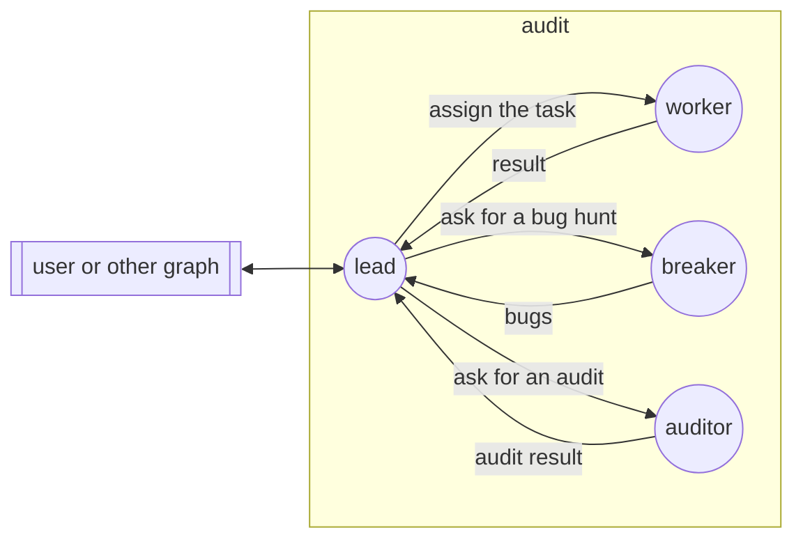

## Boundaries

- No communication with nodes outside the graph, except through `external`.
- Graph management (`/graph-up`, `/graph-down`, `/node-invite`, `/node-down`)
  is permitted with any gossip peer.
- No file changes outside the git branch of the graph.
- Reading files outside the working tree is permitted. No file changes
  outside the working tree.
- All nodes work on the same host, in the same working tree.
- The worker is the only node that changes source files.
- No node skips, deletes, or weakens a test to make it pass.

## Edges

### assign

The lead sends the task to the worker. The message gives the path of the
repository, the branch, the guide, and the acceptance commands.

The lead also uses this edge to send findings to fix, and to answer a
question of the worker.

### result

When the worker finishes a step, it sends the commits, the output of the
acceptance commands, and a short summary to the lead.

The worker also uses this edge to ask a question.

### ask-break

The lead sends the diff from the base commit to the breaker. The message
holds the diff only: no guide, no summary, and no earlier findings. Then the
lead waits for `break-result`.

### break-result

The breaker sends the bugs that it found to the lead, one per line, the most
severe first. Each finding has a severity: `blocker`, `concern`, or `nit`.

### ask-audit

The lead sends the diff from the base commit, the guide, and the output of
the acceptance commands to the auditor. Then the lead waits for
`audit-result`.

### audit-result

The auditor sends its findings to the lead, one per line, the most severe
first. Each finding has a severity: `blocker`, `concern`, or `nit`.

### external

All messages from and to the user or other graphs go through the lead. The
lead gives the final result to the user.
