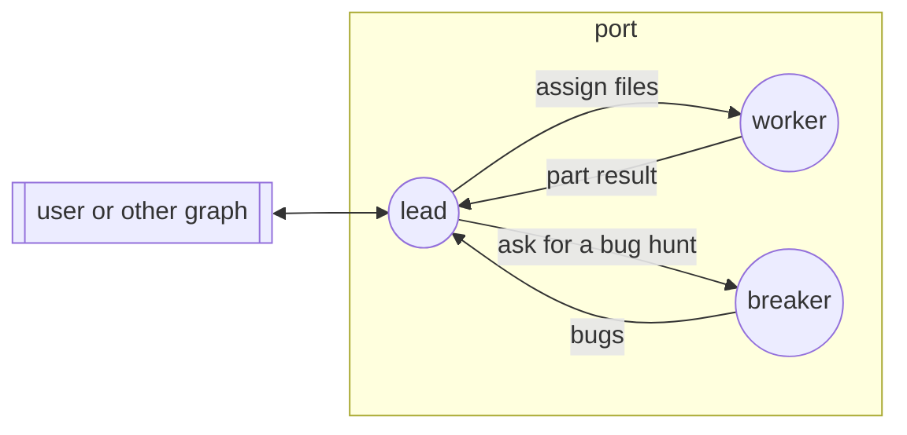

## Boundaries

- No communication with nodes outside the graph, except through `external`.
- Graph management (`/graph-up`, `/graph-down`, `/node-invite`, `/node-down`)
  is permitted with any gossip peer.
- No file changes outside the git branch of the graph.
- Reading files outside the working tree is permitted. No file changes
  outside the working tree.
- All nodes work on the same host, in the same working tree. The workers
  share one git index.
- No node skips, deletes, or weakens a test to make it pass.

## Edges

### assign

The lead sends a set of files to a worker. The message gives the path of the
repository, the branch, the guide, the acceptance commands, and the files
that the worker can change. Each file has one owner. Shared files, such as
`Cargo.toml` or a `mod.rs`, also get one owner.

The lead also uses this edge to send findings to fix, and to answer a
question of the worker.

### part-result

When a worker finishes its files, it sends the commits, the output of the
acceptance commands, and a short summary to the lead.

The worker also uses this edge to ask a question, to ask for a file that is
not its file, or to report an error in a file that is not its file.

### ask-break

The lead sends the diff of one part, and the guide, to the breaker. The
message holds no summary and no earlier findings. Then the lead waits for
`break-result`.

### break-result

The breaker sends its findings to the lead, one per line, the most severe
first. Each finding has a severity: `blocker`, `concern`, or `nit`.

### external

All messages from and to the user or other graphs go through the lead. The
lead gives the final result to the user.
