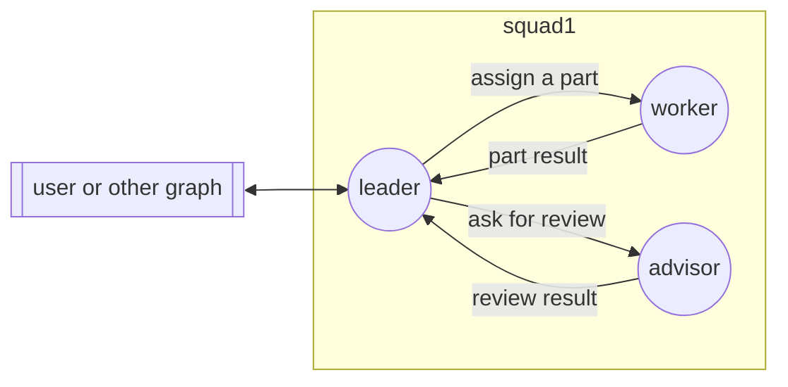

## Boundaries

- No communication with nodes outside the graph, except through `external`.
- Graph management (`/graph-up`, `/graph-down`, `/graph-node-invite`,
  `/graph-leave`) is permitted with any gossip peer.
- No file changes outside the git branch of the graph.
- Reading files outside the working tree is permitted. No file changes
  outside the working tree.
- All nodes work on the same host, in the same working tree. The workers
  share one git index.

## Questions for the user

The leader is the only node that talks to the user. Its meta entry has
`"leader":true`. The leader of your graph is the peer with `"leader":true`, the
same `instance` and `hash` as you, that is not in `absent`. Read the meta each
time you ask, because the leader can change.

A node that is not the leader never asks the user. When it needs an answer
from the user, it opens a gossip task to the leader with the label
`question · <short question>`. The text holds the question and the choices, if
any. Then it keeps working on what it can. The artifact of the task is the
answer: approve it on the batch in which it arrives. If the question belongs
to a task that the leader gave you, ask it with `input-required` on that task
instead.

If there is no live leader, do not ask the user. Keep working, and read the
meta again on each later batch. If you cannot go on without the answer, say so
in the result of your task.

The leader accepts a task labelled `question ·` at once. This replaces the
accept or decline question of gossip-task: do not ask the user whether to
accept. It asks the user the question with the question tool, or in chat if
the session has no such tool. Then it sends the answer as the artifact of the
task, and closes the task when the asker approves. For an `input-required`
question on a task of its own, it relays the answer on that task.

## Edges

### assign

The leader sends a part of the task to a worker. The message gives the
path of the repository, the branch, the part, and the files that the worker
can change. Each file has one owner. Shared files, such as `Cargo.toml` or a
`mod.rs`, also get one owner.

A small task can have only one part. If a part needs the result of another
part, the leader sends it after the other part is complete.

The leader also uses this edge to send a repair request or an answer to
a question of the worker.

### part-result

When a worker finishes its part, it sends the commits and a short summary to
the leader.

The worker also uses this edge to ask a question, to ask for a file that is
not its file, or to report an error in a file that is not its file.

### ask-review

The leader sends the plan, or the diff from the base commit, to the
advisor. Then it waits for `review-result`.

### review-result

The advisor sends its findings to the leader, one per line, the most
severe first. Each finding has a severity: `blocker`, `concern`, or `nit`.

### external

All messages from and to the user or other graphs go through the
leader. The leader gives the final result to the user.
