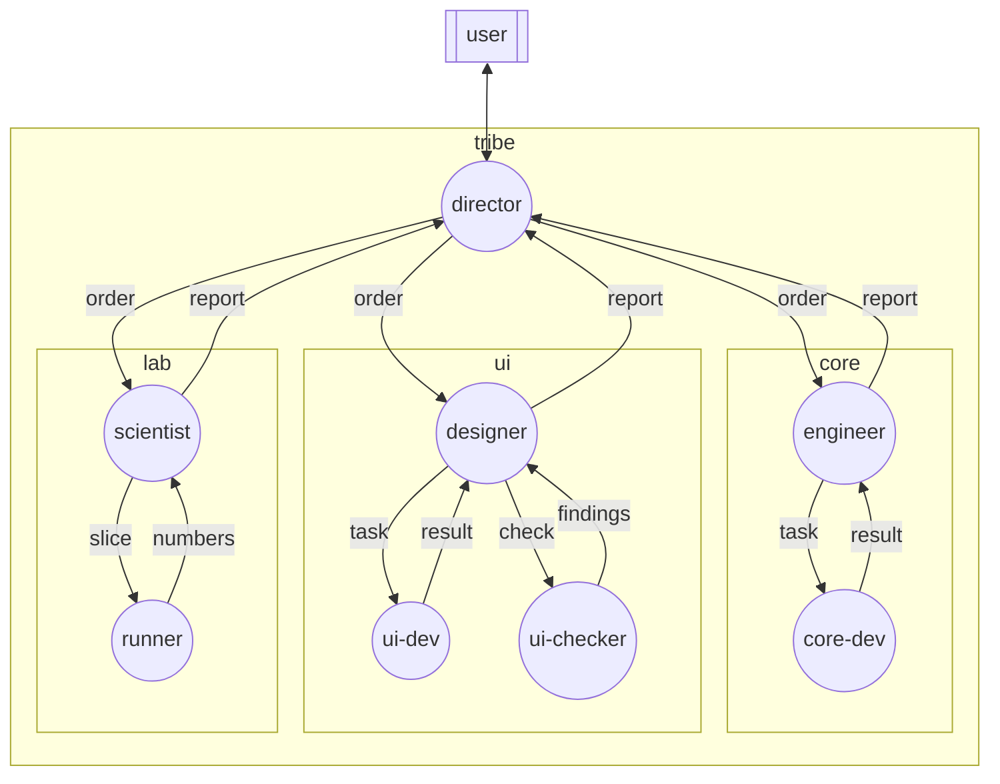

## Boundaries

- No communication with nodes outside the graph, except through `external`.
- The user talks only to the director. The director talks only to the three
  leads (`engineer`, `designer`, `scientist`). Each member talks only to the
  lead of its squad.
- No lead talks to another lead. No member talks to another squad, to the
  director, or to the user.
- The user can open the session of any node to answer a permission prompt
  (*Stuck session*).
- Graph management (`/graph-up`, `/graph-down`, `/graph-node-invite`,
  `/graph-leave`) is permitted with any gossip peer.
- `.agent-graph/` changes only through a merged pull request. The director
  starts the graph from the main clone, on the default branch.
- The director works in the main clone, which stays on the default branch.
  Each squad works in its own fixed worktree, for example `../<repo>-core`,
  `../<repo>-ui`, and `../<repo>-lab`.
- A peer works in the worktree of its squad, not in the folder where its
  session started. The order and the task give the path.
- The nodes of a squad work on the same host. A `runner` works in its own
  worktree, or in its own clone on another host.
- Reading files outside the working tree is permitted. No file changes
  outside the worktree of the node.
- No changes to a file that another squad owns. Ask the director
  (*Folder owners*).

## Edges

### order-core

The director sends to the `engineer` an issue, a decision of the user (an
approved plan, an approved merge, or the end of a dispute), or the news that
a pull request of another squad is merged. The form is in *Order*.

### order-ui

Like `order-core`, to the `designer`.

### order-lab

Like `order-core`, to the `scientist`.

### report-core

The `engineer` sends to the director a plan that is ready, a result, a merge
that is done, a dispute, or a request for a file of another squad. The form
is in *Report*.

### report-ui

Like `report-core`, from the `designer`.

### report-lab

Like `report-core`, from the `scientist`.

### task-core

The `engineer` sends one step of the plan to the `core-dev`. The form is in
*Task*.

The `engineer` also uses this edge to send a repair request or an answer to
a question of the `core-dev`.

### result-core

The `core-dev` sends back the step that is done, a question, or an error in a
file that is not its file. The form is in *Result*.

### task-ui

Like `task-core`, from the `designer` to the `ui-dev`, with the spec of the
screen.

### result-ui

Like `result-core`, from the `ui-dev` to the `designer`.

### check-ui

The `designer` asks the `ui-checker` for screenshots of the base commit at the
start of the issue, and of the branch at the end.

### findings-ui

The `ui-checker` sends the lists of screenshots that are the same, changed,
new, and gone, and each hard-coded color, size, or text, with the file and the
line. No verdict.

### slice-lab

The `scientist` sends one slice of an experiment to a `runner`: the commit,
the inputs, the command, the environment, the place for the outputs, and the
deadline.

### numbers-lab

The `runner` sends back the inputs that are done, the inputs that failed and
why, the time, and the place of the outputs. Numbers, no conclusion.

### external

All messages from and to the user go through the director. The user gives
the orders, approves plans and merges, and gets each result as options, cost,
risk, and a recommendation, with the plan or the pull request attached.

@shared/rules.md
